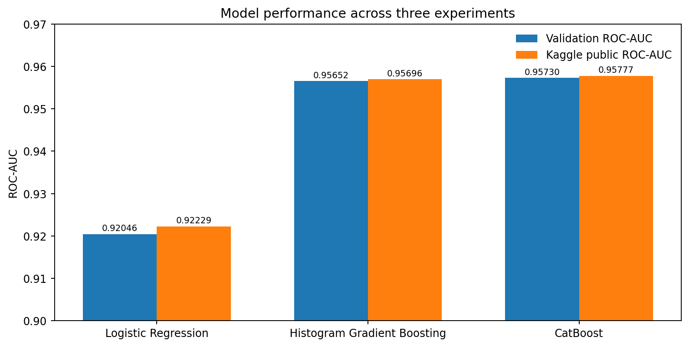

# Airline Passenger Satisfaction — Kaggle Classification

An end-to-end tabular machine learning project developed for Kaggle's **Predicting Airline Satisfaction** competition. The objective is to predict the probability that a passenger is satisfied, using passenger characteristics, flight information, and service ratings.

**Evaluation metric:** ROC-AUC  
**Best public leaderboard score:** **0.95777** (CatBoost)

## Approach

1. **Exploratory analysis:** Examine target balance, missing data, numerical associations, categorical satisfaction rates, and train/test consistency.
2. **Baseline:** Train Logistic Regression with imputation, scaling, and one-hot encoding.
3. **Nonlinear model:** Evaluate scikit-learn's Histogram Gradient Boosting on the same stratified validation split.
4. **Categorical boosting:** Train CatBoost with native categorical feature handling and validation-based early stopping.
5. **Submission:** Generate predicted probabilities, validate the submission schema and row alignment, and write separate CSVs for each model.

All models use the same **80/20 stratified train-validation split** (`random_state=42`). Preprocessing for the scikit-learn models is fitted within pipelines to avoid training/validation leakage.

## Results

| Model | Validation ROC-AUC | Kaggle public ROC-AUC |
|---|---:|---:|
| Logistic Regression | 0.92046 | 0.92229 |
| Histogram Gradient Boosting | 0.95652 | 0.95696 |
| **CatBoost** | **0.95730** | **0.95777** |

The largest gain came from moving beyond the linear baseline. CatBoost produced the highest observed score, although its improvement over Histogram Gradient Boosting was modest. Public leaderboard scores are not final private leaderboard results.

## Key findings

- **Travel class and travel purpose are strongly associated with observed satisfaction.** In the training data, satisfaction was approximately **72.5% in Business class** versus **16.8% in Economy**, and **58.4% for business travel** versus **9.7% for personal travel**. These are descriptive associations, not causal effects.
- Switching from Logistic Regression to nonlinear boosting delivered the largest gain in ROC-AUC. CatBoost achieved the best observed public score, but the difference from Histogram Gradient Boosting is small.
- The modeling notebook includes **CatBoost feature importance** and **validation ROC-AUC by travel class and travel type**. These analyses run locally alongside model training; their outputs should be interpreted after executing the notebook.



## Repository structure

```text
.
├── data/
│   └── raw/                 # Downloaded Kaggle CSV files (not tracked)
├── notebooks/
│   ├── 01_eda.ipynb
│   └── 02_modeling.ipynb
├── submissions/             # Generated CSV files (not tracked)
├── assets/
│   └── model_comparison.png
├── .gitignore
├── requirements.txt
└── README.md
```

## Reproduce

1. Clone the repository and install dependencies:

   ```bash
   python -m pip install -r requirements.txt
   ```

2. Download `train.csv`, `test.csv`, and `sample_submission.csv` from the [Kaggle competition](https://www.kaggle.com/competitions/playground-series-s6e10) and place them in `data/raw/`.
3. Open the notebooks with Jupyter, **using `notebooks/` as the working directory**, and run `01_eda.ipynb` followed by `02_modeling.ipynb`.
4. The modeling notebook writes validated predictions to `submissions/`.

## Limitations

This was a first-pass modeling exercise rather than an exhaustive optimization study. Results use a single validation split; CatBoost also uses that split for early stopping. The small difference between the two boosting models should therefore not be interpreted as definitive evidence that one consistently outperforms the other. Feature importance is model-specific, and subgroup comparisons are descriptive; neither identifies causal effects.

## Tools

Python, pandas, NumPy, scikit-learn, CatBoost, matplotlib, Jupyter.

## Author

**Ignacio Spreafico**

- LinkedIn: [linkedin.com/in/ignacio-spreafico](https://www.linkedin.com/in/ignacio-spreafico)
- Portfolio: [ignaciospreafico.vercel.app](https://ignaciospreafico.vercel.app)
- Email: [nachospreafico06@gmail.com](mailto:nachospreafico06@gmail.com)